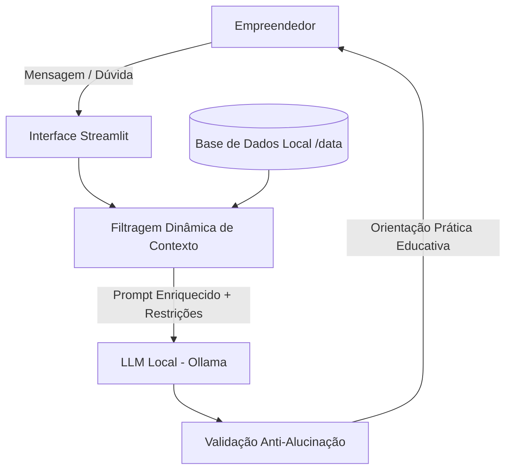

# 🤖 Agente Financeiro Inteligente: Caio

Assistente financeiro consultivo, acessível e sem julgamentos, desenvolvido para orientar novos empreendedores e pequenos empresários na gestão financeira do seu negócio.

---

## 📌 Contexto & Caso de Uso

Grande parte das micro e pequenas empresas encerra as suas atividades nos primeiros anos de operação por dificuldades na gestão de tesouraria básica, formação incorreta de preços e mistura de contas pessoais com as da empresa.

O **Caio** atua como um parceiro consultivo que ingere a rotina operacional do negócio (perfil cadastral, catálogo de produtos, fluxo de caixa e histórico de suporte) para:
- **Antecipar gargalos:** Alertar sobre despesas concentradas e descasamentos entre prazos de recebimento e pagamento.
- **Evitar desperdícios:** Analisar margens de contribuição e apontar riscos em itens de baixo giro.
- **Educar sem decidir:** Capacitar o pequeno empresário com perguntas reflexivas e simulações práticas, preservando a autonomia e a privacidade do gestor.

---

## 🛠️ Arquitetura & Tecnologias

A aplicação foi concebida para execução totalmente local, garantindo que dados financeiros e confidenciais nunca saiam do ambiente do cliente.



- **Interface:** [Streamlit](https://streamlit.io/)
- **Processamento de Dados:** [Pandas](https://pandas.pydata.org/)
- **LLM Local:** [Ollama](https://ollama.ai/)
- **Estratégia Anti-Alucinação:** Few-shot prompting, grounded context (dados delimitados) e restrição estrita a decisões executivas.

---

## 📂 Base de Conhecimento (`data/`)

Os dados da aplicação simulam a operação da **Cafeteria & Padaria Pão D'Ouro**:

| Arquivo | Formato | Finalidade |
|---|---|---|
| `perfil_empresa.json` | JSON | Dados cadastrais, regime tributário (Simples Nacional), indicadores gerais (faturamento, custos fixos e capital de giro) e desafios declarados pelo proprietário. |
| `produtos.json` | JSON | Catálogo com custos unitários, preços sugeridos e classificação de facilidade de venda (`baixa`, `media`, `alta`). |
| `transacoes.csv` | CSV | Registro diário de receitas e despesas com categorização e formas de liquidação. |
| `historico_atendimento.csv` | CSV | Registo de atendimentos e conselhos anteriores para manter a coerência pedagógica das respostas. |

---

## 📁 Estrutura do Repositório

```
📁 lab-agente-financeiro/
│
├── 📄 README.md                      # Apresentação e guia do projeto
├── 📄 requirements.txt               # Dependências do projeto (streamlit, pandas, ollama)
│
├── 📁 data/                          # Base de dados estruturada da empresa
│   ├── perfil_empresa.json           # Perfil cadastral e métricas financeiras
│   ├── produtos.json                 # Produtos, custos e facilidade de venda
│   ├── transacoes.csv                # Entradas e saídas de caixa
│   └── historico_atendimento.csv     # Histórico de interações com o agente
│
├── 📁 docs/                          # Documentação detalhada
│   ├── 01-documentacao-agente.md     # Persona, tom de voz, escopo e arquitetura
│   ├── 02-base-conhecimento.md       # Estratégia de dados e injeção de contexto
│   ├── 03-prompts.md                 # System prompt, exemplos few-shot e edge cases
│   ├── 04-metricas.md                # Avaliação de assertividade e anti-alucinação
│   └── 05-pitch.md                   # Roteiro de apresentação de 3 minutos
│
├── 📁 src/                           # Código-fonte da aplicação
│   └── app.py                        # Interface Streamlit e orquestração do Caio
│
└── 📁 assets/                        # Imagens, fluxogramas e diagramas
```

---

## 🚀 Como Executar

### 1. Pré-requisitos
- Python 3.10 ou superior
- [Ollama](https://ollama.ai/) instalado e a correr localmente

### 2. Instalação das dependências
Clone o repositório e instale as bibliotecas necessárias:
```bash
pip install -r requirements.txt
```

### 3. Modelo Local
Certifique-se de que o Ollama possui o modelo descarregado (por exemplo, `llama3` ou `mistral`):
```bash
ollama run llama3
```

### 4. Executar a Aplicação
Inicie a interface interativa:
```bash
streamlit run src/app.py
```

---

## 🔒 Diretrizes de Segurança e Anti-Alucinação

1. **Apenas Factos Presentes:** O Caio responde estritamente a partir dos números injetados no contexto.
2. **Sem Decisões Arbitrárias:** Nunca assume papel de liderança executiva (ex.: não ordena demissões nem aumento imediato de preços); foca-se na capacitação do empresário.
3. **Transparência:** Quando uma informação financeira não constar nos ficheiros carregados, o agente assume a limitação e orienta sobre quais dados devem ser fornecidos.